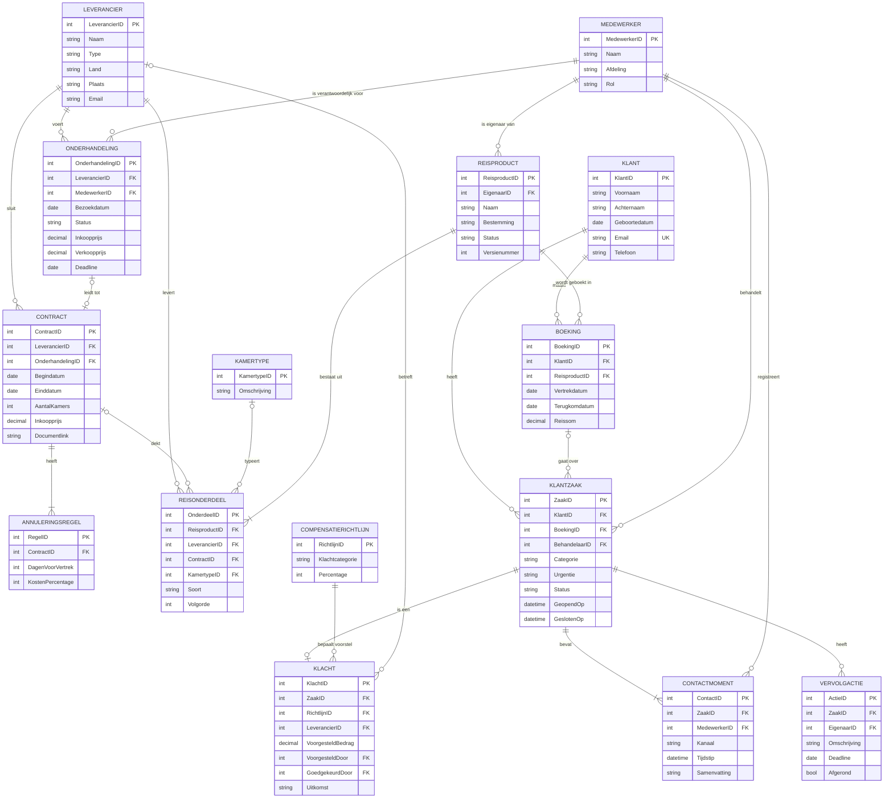

# Conceptueel ERD – Inkoop & Klantenservice

Hoofdentiteiten van Productontwikkeling & Inkoop en Klantenservice & Support, met sleutels en kardinaliteiten. Dit is het **conceptuele** model: alleen de entiteiten en relaties die nodig zijn om de use cases uit te voeren. Het fysieke databaseschema (alle kolommen en datatypes) werkt dit later uit.

Afbeelding: [`erd-conceptueel.png`](erd-conceptueel.png)

## Toelichting per entiteit

| Entiteit | Afdeling | Waarom nodig | Bron |
| --- | --- | --- | --- |
| Leverancier | Inkoop | Eén centrale plek voor hotels, vervoerders en rederijen | KP1, GP1, interview I6 |
| Onderhandeling | Inkoop | Eigen tabel in plaats van één statuskolom, zodat eerdere voorstellen bewaard blijven | KP1, interview I3–I4 |
| Contract | Inkoop | Looptijd, aantal kamers en inkoopprijs; einddatum ≥ begindatum | KP5, interview I5 |
| Annuleringsregel | Inkoop | Voorwaarden als regels (“vanaf X dagen: Y%”) in plaats van vrije tekst | Interview I10 |
| Kamertype | Inkoop | Vaste lijst, zodat klant en verkoper hetzelfde verstaan onder een kamer | Interview I7 |
| Reisproduct / Reisonderdeel | Inkoop | Product is opgebouwd uit onderdelen van verschillende leveranciers | KP2, GP1 |
| Medewerker | Beide | Wie is verantwoordelijk, wie registreert, wie keurt goed (vier ogen) | KP2, K8 |
| Klant | Klantenservice | Uniek via e-mailadres; alleen gegevens zoals in het paspoort, **geen IBAN of paspoortnummer** | P1–P4 |
| Boeking | Sales (verwijzing) | Nodig om te zien of de klant op reis is; eigendom van Sales & Boekingen | K1, P3 |
| Klantzaak / Contactmoment | Klantenservice | Eén dossier per vraag of klacht, met alle contacten chronologisch | KP1, KP4, GP1 |
| Klacht / Compensatierichtlijn | Klantenservice | Voorstel = percentage × reissom; voorgesteld en goedgekeurd door verschillende medewerkers | K9, KP3 |
| Vervolgactie | Klantenservice | Wat er nog moet gebeuren, met eigenaar en deadline | K6 |

## Bedrijfsregels in het model

- `KLANT.Email` is uniek (UK).
- `CONTRACT.Einddatum ≥ CONTRACT.Begindatum`; `AantalKamers > 0`.
- `ANNULERINGSREGEL.KostenPercentage` tussen 0 en 100.
- `KLACHT.GoedgekeurdDoor ≠ KLACHT.VoorgesteldDoor` (vier-ogenprincipe).
- Klantgegevens mogen pas worden verwijderd of geanonimiseerd als de terugkomdatum van alle boekingen voorbij is.
- Een klantzaak kan niet worden afgesloten zolang er open vervolgacties zijn.
