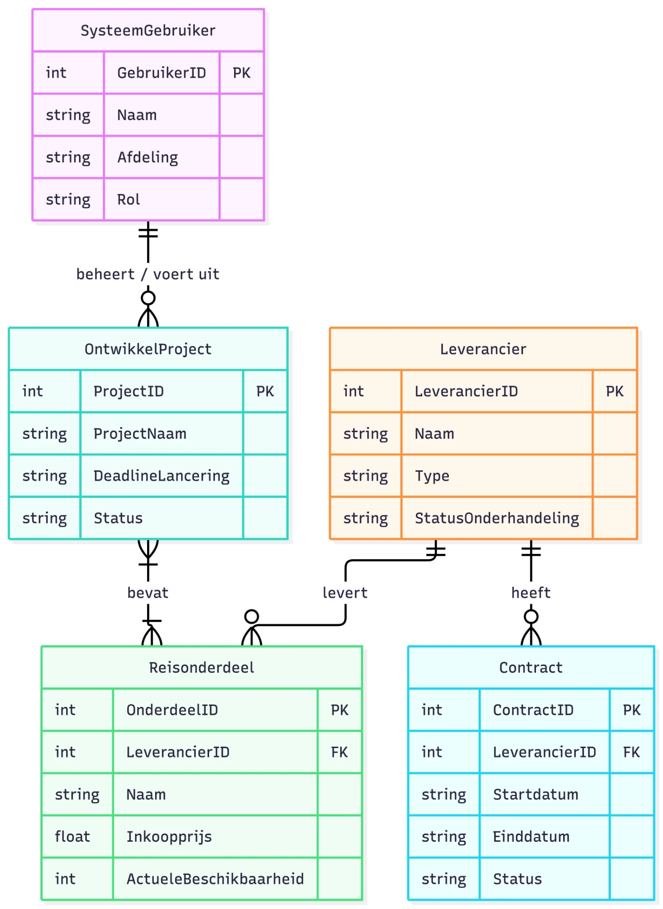
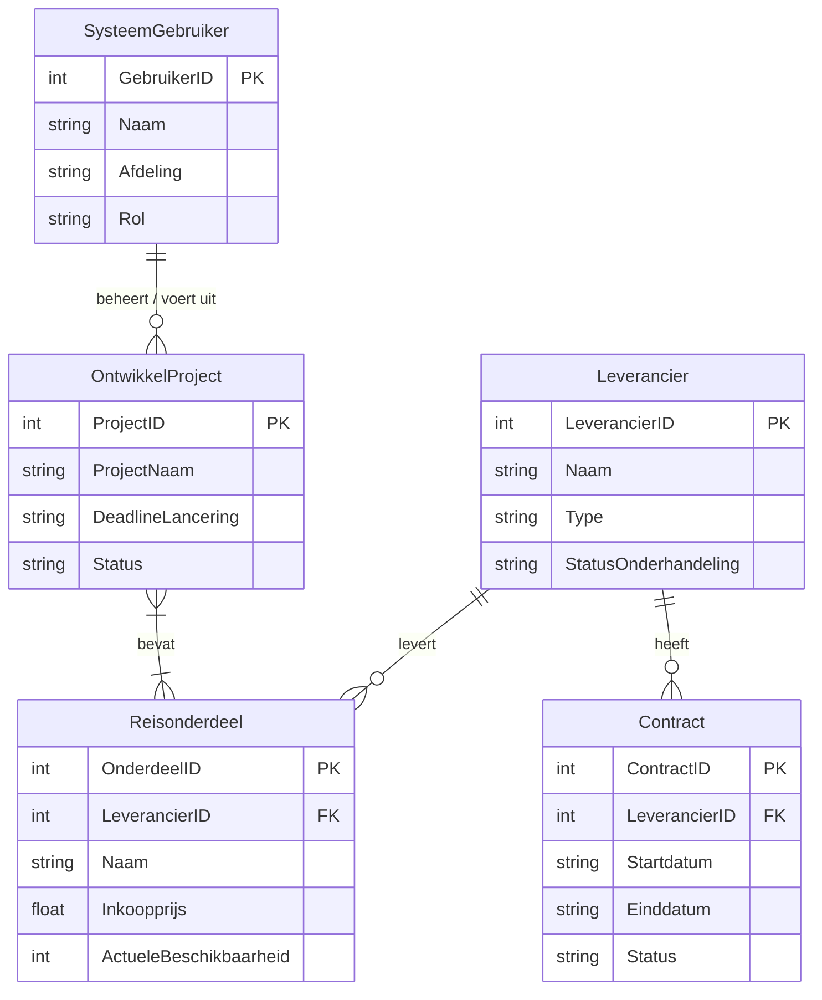
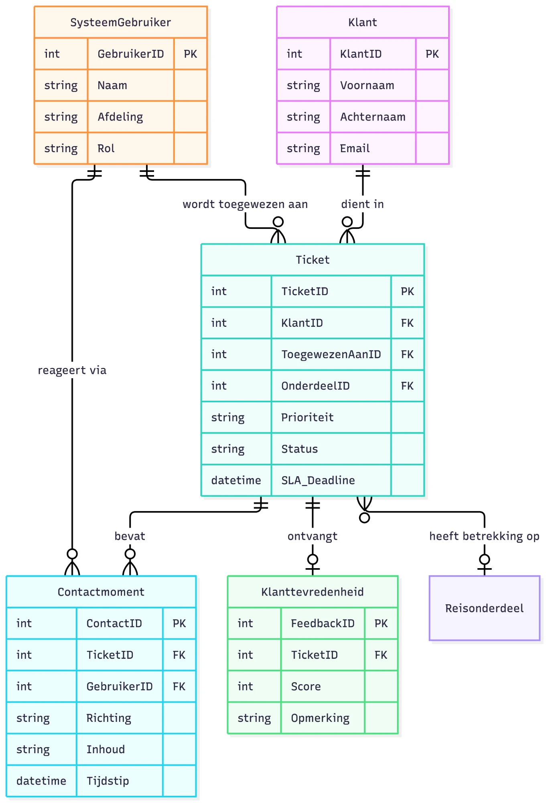
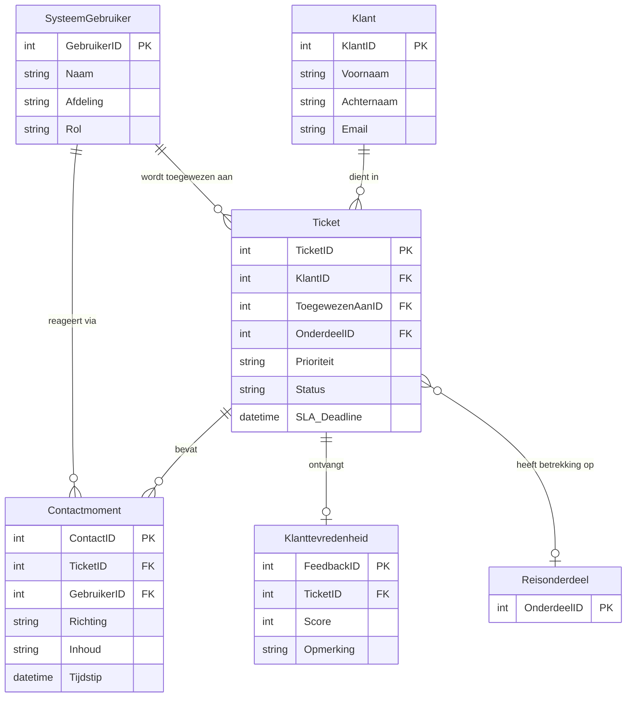

# ERD Productontwikkeling & Inkoop en Klantenservice & Support

**Stand:** 1 oktober 2026 (sprintreview) · **GitHub:** #158 en #178 (hoofdentiteiten, afgerond) · **Vervolg:** #156, #157, #179, #180

Het datamodel van Team 3 bestaat uit twee ERD’s, één per afdeling. **SysteemGebruiker** komt in beide voor, en een ticket van Klantenservice kan verwijzen naar een **Reisonderdeel** van Inkoop. Samen zijn het negen entiteiten.

## 1. ERD Productontwikkeling & Inkoop

| Relatie | Kardinaliteit | Betekenis |
| --- | --- | --- |
| SysteemGebruiker – OntwikkelProject | 1 : 0..n | Een gebruiker beheert of voert nul of meer ontwikkelprojecten uit. |
| OntwikkelProject – Reisonderdeel | 1..n : 1..n | Een project bevat één of meer reisonderdelen; een reisonderdeel kan in meerdere projecten zitten. |
| Leverancier – Reisonderdeel | 1 : 0..n | Een leverancier levert nul of meer reisonderdelen. |
| Leverancier – Contract | 1 : 0..n | Een leverancier heeft nul of meer contracten. |

## 2. ERD Klantenservice & Support

| Relatie | Kardinaliteit | Betekenis |
| --- | --- | --- |
| Klant – Ticket | 1 : 0..n | Een klant dient nul of meer tickets in (vraag of klacht). |
| SysteemGebruiker – Ticket | 1 : 0..n | Een ticket wordt toegewezen aan één medewerker. |
| Ticket – Contactmoment | 1 : 0..n | Alle contacten over een ticket staan bij elkaar. |
| SysteemGebruiker – Contactmoment | 1 : 0..n | Vastgelegd wie heeft gereageerd. |
| Ticket – Klanttevredenheid | 1 : 0..1 | Na afhandeling kan de klant één beoordeling geven. |
| Ticket – Reisonderdeel | 0..n : 0..1 | Een ticket kan over een reisonderdeel gaan, bijvoorbeeld een hotel. |

## 3. Waarom deze entiteiten

| Entiteit | Afdeling | Waarom nodig | Bron |
| --- | --- | --- | --- |
| SysteemGebruiker | Beide | Wie een project beheert, een ticket behandelt of reageert | Use cases, interview K5 |
| OntwikkelProject | Inkoop | Voortgang en deadline van een nieuw reisproduct volgen | UC01, UC09, interview I1 |
| Leverancier | Inkoop | Eén centrale plek voor hotels en andere leveranciers, met de stand van de onderhandeling | UC04, UC05, UC07, interview I3–I4 |
| Reisonderdeel | Inkoop | Product opgebouwd uit onderdelen van leveranciers, met prijs en beschikbaarheid | UC01, interview I5, I7 |
| Contract | Inkoop | Looptijd en status van afspraken met een leverancier | UC08, UC09 |
| Klant | Klantenservice | Klant uniek terugvinden, op e-mailadres | UC-K02, interview K1 |
| Ticket | Klantenservice | Eén dossier per vraag of klacht, met prioriteit en SLA-deadline | UC-K04, UC-K05, UC-K06 |
| Contactmoment | Klantenservice | Elk contact gestructureerd vastleggen in plaats van één vrij tekstveld | UC-K01, UC-K03, interview K3 |
| Klanttevredenheid | Klantenservice | Afhandeling laten beoordelen en trends zien | UC-K08 |

## 4. Aandachtspunten voor het logisch ERD (sprint 3)

Dit zijn suggesties voor de uitwerking in #157 en #179; het team beslist.

- **Veel-op-veel tussen OntwikkelProject en Reisonderdeel** wordt in het logisch ERD een koppeltabel (bijvoorbeeld *ProjectOnderdeel*).
- **Datums als datum opslaan:** `Contract.Startdatum`, `Contract.Einddatum` en `OntwikkelProject.DeadlineLancering` staan nu als *string*. Als *date* kan het systeem controleren dat de einddatum na de begindatum ligt en een signaal geven bij aflopende contracten (UC09).
- **Status van de onderhandeling** staat nu als één veld bij Leverancier. Wil het team eerdere voorstellen bewaren (UC04), dan wordt *Onderhandeling* een eigen entiteit.
- **Klant:** voor UC-K02 (gelijknamige klanten onderscheiden) en de AVG-blokkade zolang een klant op reis is (UC-K09) zijn geboortedatum, telefoon en een koppeling naar de reis nodig. Geen IBAN of paspoortnummer opslaan (interview P1–P2).
- **Compensatie bij klachten** (UC-K07, vier-ogenprincipe) heeft nog geen plek: denk aan velden *VoorgesteldDoor* en *GoedgekeurdDoor* bij Ticket, of een aparte entiteit.
- **SysteemGebruiker** is in beide ERD’s gelijk; houd hem in het gezamenlijke model als één tabel.
