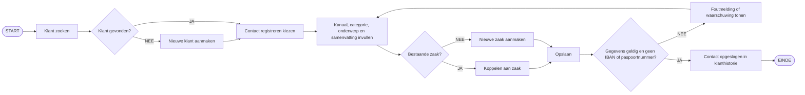
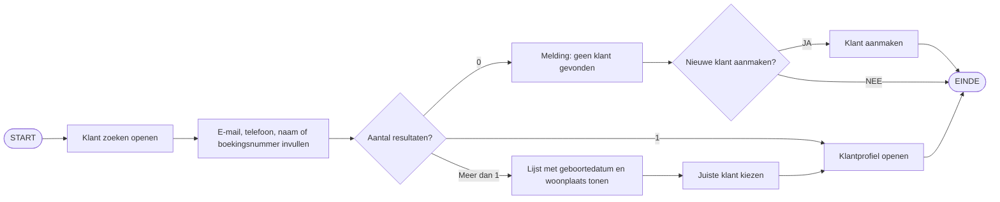
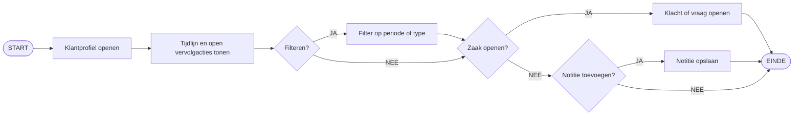
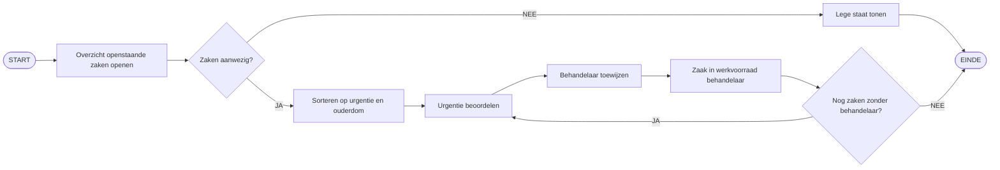
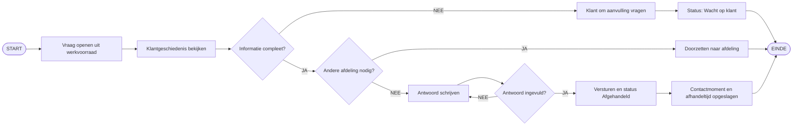
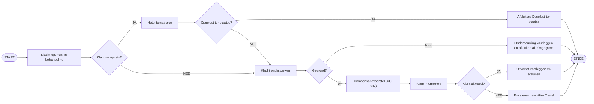
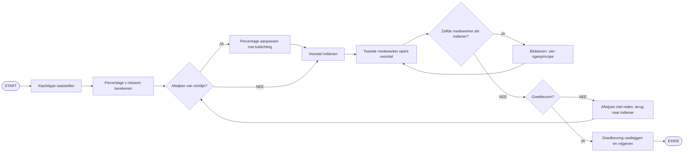
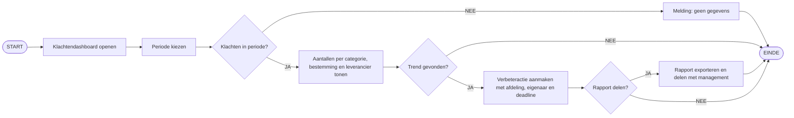
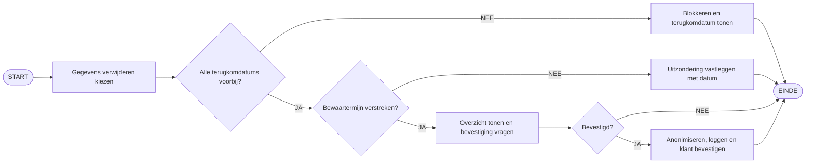

# Use cases Klantenservice & Support

Beschrijvingen en user flows bij het primaire use-casediagram “Klantvragen en klachten afhandelen” op het FigJam-board. Opbouw gelijk aan de beschrijvingen van Productontwikkeling & Inkoop. Nummering: **UC-K01 t/m UC-K09**; de bijbehorende user story staat erbij.

Actoren: **Klantenservicemedewerker** (ook shopmedewerker), **Teamleider klantenservice** (in het diagram: Manager), **After Travel** (secundair), **Klant** (secundair, ontvangt berichten).

---

## UC-K01 Klantcontact registreren

| | |
| --- | --- |
| Use case | UC-K01 Klantcontact registreren (user story #121) |
| Doel | Elk contact met een klant wordt gestructureerd vastgelegd, zodat het niet verloren gaat en collega’s dezelfde verhaallijn zien. |
| Primaire actor | Klantenservicemedewerker |
| Trigger | Een klant belt, mailt, komt in de shop of stuurt een bericht via social media. |
| Preconditie | De medewerker is ingelogd. |
| Hoofdscenario | 1. De medewerker zoekt de klant op (include UC-K02). 2. Het systeem toont het klantprofiel met open zaken. 3. De medewerker kiest “Contact registreren”. 4. De medewerker kiest kanaal en categorie en vult onderwerp en samenvatting in. 5. De medewerker koppelt het contact aan een open zaak of maakt een nieuwe zaak. 6. De medewerker klikt op Opslaan. 7. Het systeem controleert de verplichte velden en controleert de samenvatting op IBAN- of paspoortnummers. 8. Het systeem slaat het contact op met datum, tijd en medewerker en toont het bovenaan de klanthistorie. |
| Postconditie | Het contactmoment staat in het klantdossier, gekoppeld aan een klantzaak. |
| Alternatieve scenario’s | **2a. Klant bestaat nog niet:** de medewerker maakt een nieuwe klant aan (extend) en gaat verder bij stap 3. **5a. Vervolgcontact:** de medewerker koppelt aan de bestaande zaak (extend). **6a. Bijlage:** de medewerker voegt een bestand toe (extend). **7a. Verplicht veld leeg:** het systeem toont per veld een foutmelding; de invoer blijft staan. **7b. IBAN of paspoortnummer gevonden:** het systeem waarschuwt en slaat de tekst niet op (AVG, interview P1–P2). |

## UC-K02 Klant zoeken op e-mailadres

| | |
| --- | --- |
| Use case | UC-K02 Klant zoeken op e-mailadres (user story #120) |
| Doel | De medewerker vindt altijd de juiste, unieke klant. |
| Primaire actor | Klantenservicemedewerker |
| Trigger | De medewerker wil een klant of boeking opzoeken. |
| Preconditie | De medewerker is ingelogd. |
| Hoofdscenario | 1. De medewerker opent “Klant zoeken”. 2. De medewerker vult een e-mailadres, telefoonnummer, naam of boekingsnummer in. 3. Het systeem zoekt. 4. Het systeem toont precies één klantprofiel. 5. De medewerker opent het profiel. |
| Postconditie | Het juiste klantprofiel is geopend. |
| Alternatieve scenario’s | **4a. Zoeken op naam geeft meerdere klanten:** het systeem toont geboortedatum en woonplaats per klant en waarschuwt voor gelijknamige klanten (bijv. Sr./Jr.); de medewerker kiest de juiste. **4b. Geen resultaat:** het systeem toont “Geen klant gevonden” en een knop “Nieuwe klant”. |

## UC-K03 Klantgeschiedenis raadplegen

| | |
| --- | --- |
| Use case | UC-K03 Klantgeschiedenis raadplegen (user story #124) |
| Doel | De medewerker ziet direct wat er eerder met de klant is gebeurd en hoeft niets opnieuw te vragen. |
| Primaire actor | Klantenservicemedewerker |
| Trigger | De medewerker wil een klant verder helpen. |
| Preconditie | De medewerker is ingelogd en de klant is gevonden (UC-K02). |
| Hoofdscenario | 1. De medewerker opent het klantprofiel. 2. Het systeem toont de tijdlijn: contactmomenten, klachten en boekingen, nieuwste eerst. 3. Het systeem toont open vervolgacties bovenaan. 4. De medewerker bekijkt de relevante contacten en afspraken. |
| Postconditie | De medewerker heeft een volledig beeld van de klant. |
| Alternatieve scenario’s | **2a. Filteren:** de medewerker filtert op periode of type (extend). **4a. Zaak openen:** de medewerker opent een klacht direct vanuit de tijdlijn (extend). **4b. Notitie:** de medewerker voegt een interne notitie toe (extend). **2b. Nog geen contacten:** het systeem toont “Nog geen contactgeschiedenis”. |

## UC-K04 Openstaande zaken prioriteren en verdelen

| | |
| --- | --- |
| Use case | UC-K04 Openstaande zaken prioriteren en verdelen (user stories #126, #127) |
| Doel | Urgente zaken worden eerst opgepakt en elke zaak heeft een behandelaar. |
| Primaire actor | Teamleider klantenservice |
| Trigger | Het begin van de dienst, of een melding over een te lang wachtende zaak. |
| Preconditie | De teamleider is ingelogd; er zijn openstaande zaken. |
| Hoofdscenario | 1. De teamleider opent het overzicht openstaande zaken. 2. Het systeem toont de zaken gesorteerd op urgentie en ouderdom; zaken van klanten die nu op reis zijn staan automatisch op urgentie Hoog. 3. De teamleider beoordeelt de urgentie en past die zo nodig aan. 4. De teamleider wijst een behandelaar toe. 5. Het systeem zet de zaak in de werkvoorraad van de behandelaar en legt vast wie wanneer toewees. |
| Postconditie | Elke openstaande zaak heeft een urgentie en een behandelaar. |
| Alternatieve scenario’s | **2a. Achterstallige zaken:** de teamleider filtert op zaken die de reactienorm overschrijden (extend). **4a. Herverdelen:** de teamleider wijst een zaak opnieuw toe met een overdrachtsnotitie (extend). **4b. Capaciteit:** de teamleider bekijkt hoeveel zaken elke medewerker heeft (extend). **2b. Geen openstaande zaken:** het systeem toont een lege staat met uitleg. |

## UC-K05 Klantvraag beantwoorden

| | |
| --- | --- |
| Use case | UC-K05 Klantvraag beantwoorden (user story #130) |
| Doel | De klant krijgt een antwoord en het antwoord is terug te vinden. |
| Primaire actor | Klantenservicemedewerker |
| Trigger | Er staat een vraag in de werkvoorraad van de medewerker. |
| Preconditie | De medewerker is ingelogd; de zaak is aan de medewerker toegewezen. |
| Hoofdscenario | 1. De medewerker opent de vraag. 2. De medewerker bekijkt de klantgeschiedenis (include UC-K03). 3. De medewerker schrijft het antwoord. 4. De medewerker verstuurt het antwoord en zet de zaak op “Afgehandeld”. 5. Het systeem slaat het antwoord op als contactmoment en berekent de afhandeltijd. |
| Postconditie | De klant heeft een antwoord; de zaak is afgehandeld en het antwoord staat in de historie. |
| Alternatieve scenario’s | **3a. Informatie ontbreekt:** de medewerker vraagt de klant om aanvulling; de zaak krijgt status “Wacht op klant” (extend). **3b. Standaardantwoord:** de medewerker gebruikt een antwoordsjabloon (extend). **3c. Andere afdeling nodig:** de medewerker zet de vraag door (bijv. naar Sales) (extend). **4a. Antwoord leeg:** het systeem blokkeert afhandelen. |

## UC-K06 Klacht behandelen

| | |
| --- | --- |
| Use case | UC-K06 Klacht behandelen (user stories #131, #134, #143) |
| Doel | Elke klacht wordt volgens dezelfde werkwijze behandeld en afgesloten. |
| Primaire actor | Klantenservicemedewerker |
| Trigger | Een klant dient een klacht in (UC-K01). |
| Preconditie | De medewerker is ingelogd; de klacht is geregistreerd. |
| Hoofdscenario | 1. De medewerker opent de klacht (status “Nieuw”) en zet die op “In behandeling”. 2. Het systeem toont de klanthistorie en of de klant de accommodatie zelf heeft gekozen. 3. De medewerker onderzoekt de klacht en voegt bewijsmateriaal toe. 4. De medewerker beoordeelt de klacht als gegrond. 5. De medewerker laat het systeem een compensatievoorstel berekenen (include UC-K07). 6. Na goedkeuring informeert het systeem de klant over het voorstel. 7. De klant gaat akkoord; de medewerker legt de uitkomst vast. 8. De medewerker sluit de klacht af met eindresultaat “Gecompenseerd”. |
| Postconditie | De klacht is afgesloten met een vastgelegde uitkomst; de klant is geïnformeerd. |
| Alternatieve scenario’s | **2a. Klant is nu op reis:** de medewerker benadert het hotel voor een oplossing ter plaatse (escaleren naar bestemming, extend); bij succes eindresultaat “Opgelost ter plaatse”. **4a. Ongegrond:** de medewerker legt een verplichte onderbouwing vast en sluit af als “Ongegrond”. **7a. Klant maakt bezwaar:** het systeem zet de klacht op “Geëscaleerd (After Travel)”; After Travel neemt het eindbesluit. **8a. Open vervolgacties:** het systeem blokkeert afsluiten en toont welke acties openstaan. |

## UC-K07 Vergoedingsvoorstel controleren

| | |
| --- | --- |
| Use case | UC-K07 Vergoedingsvoorstel controleren (user story #132) |
| Doel | Geen compensatie gaat naar de klant zonder controle door een tweede medewerker. |
| Primaire actor | Klantenservicemedewerker (indiener) en senior medewerker (goedkeurder) |
| Trigger | Een klacht is als gegrond beoordeeld (UC-K06 stap 5). |
| Preconditie | De klacht heeft een klachtcategorie; er is een compensatierichtlijn voor die categorie. |
| Hoofdscenario | 1. Het systeem stelt het klachttype vast en haalt het richtlijnpercentage op. 2. Het systeem berekent het bedrag: percentage × reissom, en toont het als “Te controleren”. 3. De indiener controleert het voorstel en dient het in. 4. Een andere medewerker opent het voorstel. 5. De goedkeurder keurt het voorstel goed. 6. Het systeem legt indiener, goedkeurder en datum vast en geeft het voorstel vrij voor de klant. |
| Postconditie | Er is een goedgekeurd compensatievoorstel, gecontroleerd door twee verschillende medewerkers. |
| Alternatieve scenario’s | **3a. Afwijken van de richtlijn:** de indiener past het percentage aan; een toelichting is verplicht (extend). **3b. Vergelijkbare klachten:** de indiener bekijkt eerdere klachten van dezelfde categorie (extend). **4a. Indiener probeert zelf goed te keuren:** het systeem blokkeert dit (vier-ogenprincipe). **5a. Afgewezen:** de goedkeurder vult een reden in; het voorstel gaat terug naar de indiener. **2a. Percentage < 0 of > 100:** het systeem toont een foutmelding. |

## UC-K08 Terugkerende klantproblemen onderzoeken

| | |
| --- | --- |
| Use case | UC-K08 Terugkerende klantproblemen onderzoeken (user stories #140, #141) |
| Doel | Trends in klachten zien en er verbeteracties aan koppelen. |
| Primaire actor | Teamleider klantenservice |
| Trigger | Periodieke analyse (bijv. maandelijks) of een opvallend aantal klachten. |
| Preconditie | De teamleider is ingelogd; er zijn afgesloten klachten. |
| Hoofdscenario | 1. De teamleider opent het klachtendashboard. 2. De teamleider kiest een periode. 3. Het systeem toont het aantal klachten per categorie, bestemming en leverancier, gesorteerd op frequentie. 4. De teamleider vergelijkt onderwerpen en periodes. 5. De teamleider maakt een verbeteractie aan met afdeling, eigenaar en deadline. |
| Postconditie | Er is een verbeteractie vastgelegd bij de verantwoordelijke afdeling. |
| Alternatieve scenario’s | **5a. Naar andere afdeling:** de actie gaat naar Inkoop (bijv. hotel met veel klachten) (extend). **5b. Rapport:** de teamleider exporteert een rapport en deelt het met het management (extend). **3a. Te weinig gegevens:** het systeem meldt dat er in de periode geen klachten zijn. |

## UC-K09 Klantgegevens verwijderen (AVG)

| | |
| --- | --- |
| Use case | UC-K09 Klantgegevens verwijderen (AVG) (user story #139) |
| Doel | Persoonsgegevens worden verwijderd of geanonimiseerd zodra dat mag, zonder gegevens te verliezen die nog nodig zijn. |
| Primaire actor | Klantenservicemedewerker |
| Trigger | De klant vraagt om verwijdering van zijn gegevens. |
| Preconditie | De medewerker is ingelogd; de klant is gevonden (UC-K02). |
| Hoofdscenario | 1. De medewerker kiest “Gegevens verwijderen”. 2. Het systeem controleert de reisstatus: alle terugkomdatums liggen in het verleden. 3. Het systeem controleert de bewaartermijn. 4. Het systeem toont wat verwijderd wordt en vraagt om bevestiging. 5. De medewerker bevestigt. 6. Het systeem anonimiseert naam, geboortedatum, e-mail, telefoon en woonplaats, wist contactsamenvattingen en bewaart boekingen anoniem voor de financiële administratie. 7. Het systeem logt de verwijdering en stuurt de klant een bevestiging. |
| Postconditie | De klant is niet meer herleidbaar; de verwijdering is gelogd. |
| Alternatieve scenario’s | **2a. Klant is op reis of vertrekt nog:** het systeem blokkeert en toont de terugkomdatum (gegevens nodig bij calamiteiten, interview P3). **3a. Bewaartermijn loopt nog:** het systeem legt een uitzondering vast met de datum waarop verwijderen wel mag. **5a. Medewerker annuleert:** er wordt niets verwijderd. |

---

## User flows

Afbeelding met alle flows: [`user-flows-klantenservice.png`](user-flows-klantenservice.png)

### UC-K01 Klantcontact registreren

### UC-K02 Klant zoeken op e-mailadres

### UC-K03 Klantgeschiedenis raadplegen

### UC-K04 Openstaande zaken prioriteren en verdelen

### UC-K05 Klantvraag beantwoorden

### UC-K06 Klacht behandelen

### UC-K07 Vergoedingsvoorstel controleren

### UC-K08 Terugkerende klantproblemen onderzoeken

### UC-K09 Klantgegevens verwijderen (AVG)

