# Use cases Klantenservice & Support

Beschrijvingen en user flows bij het use-casediagram Klantenservice op het FigJam-board ([Project Agile Board](https://www.figma.com/board/ManUSFsMrVgktm6UwReajA/Project-Agile-Board)). Deze tekst is gelijk aan de beschrijvingstabellen op het board. Nummering: **UC-K01 t/m UC-K13**. Elke use case hoort bij één user story uit epic #5 (#199 t/m #211).

Actoren: **Klantenservicemedewerker** (ook shopmedewerker), **Manager** (teamleider klantenservice), **Senior medewerker** (tweede beoordelaar), **After Travel** (eindbesluit bij bezwaar), **Systeem**, **Klant** (secundair).

| Use case | Naam | User story |
| --- | --- | --- |
| [UC-K01](#uc-k01-klant-en-boeking-opzoeken) | Klant en boeking opzoeken | #199 |
| [UC-K02](#uc-k02-klantcontact-registreren) | Klantcontact registreren | #200 |
| [UC-K03](#uc-k03-klantdossier-en-contactgeschiedenis-raadplegen) | Klantdossier en contactgeschiedenis raadplegen | #201 |
| [UC-K04](#uc-k04-klantzaak-beheren) | Klantzaak beheren | #202 |
| [UC-K05](#uc-k05-klantzaken-prioriteren-en-toewijzen) | Klantzaken prioriteren en toewijzen | #203 |
| [UC-K06](#uc-k06-werkvoorraad-en-reactietijden-bewaken) | Werkvoorraad en reactietijden bewaken | #204 |
| [UC-K07](#uc-k07-klantvraag-onderzoeken-en-beantwoorden) | Klantvraag onderzoeken en beantwoorden | #205 |
| [UC-K08](#uc-k08-klacht-volgens-vaste-werkwijze-afhandelen) | Klacht volgens vaste werkwijze afhandelen | #206 |
| [UC-K09](#uc-k09-oplossing-of-compensatie-vastleggen) | Oplossing of compensatie vastleggen | #207 |
| [UC-K10](#uc-k10-klant-informeren-en-zaak-opvolgen) | Klant informeren en zaak opvolgen | #208 |
| [UC-K11](#uc-k11-klachten-en-klantfeedback-analyseren) | Klachten en klantfeedback analyseren | #209 |
| [UC-K12](#uc-k12-klantgegevens-en-bewaartermijnen-beheren) | Klantgegevens en bewaartermijnen beheren | #210 |
| [UC-K13](#uc-k13-privacy-en-gevoelige-gegevens-bewaken) | Privacy en gevoelige gegevens bewaken | #211 |

---

## UC-K01 Klant en boeking opzoeken

| | |
| --- | --- |
| Use case | UC-K01 - Klant en boeking opzoeken |
| Nummer | UC-K01 (user stories #199) |
| Doel | De medewerker kan een klant snel en eenduidig terugvinden en de bijbehorende boekingen en reisproductgegevens raadplegen. |
| Primaire actor | Klantenservicemedewerker |
| Trigger | Een klant neemt contact op en de medewerker wil de klant en/of boeking terugvinden. |
| Preconditie | De medewerker is ingelogd. |
| Hoofdscenario | 1. De medewerker opent Klant zoeken. 2. De medewerker vult een zoekgegeven in (bij voorkeur het e-mailadres; ook telefoon, naam of boekingsnummer). 3. Het systeem zoekt en toont de gevonden klant. 4. De medewerker opent het klantprofiel. 5. Het systeem toont de klantgegevens en gekoppelde boekingen. 6. De medewerker raadpleegt de boeking en de reisproductgegevens. |
| Postconditie | De klant is geïdentificeerd; klantgegevens, boekingen en reisproducten zijn getoond. |
| Alternatieve scenario’s | **2a.** Geen zoekgegeven ingevuld: het systeem vraagt om een zoekgegeven. **3a.** Geen klant gevonden: het systeem toont een melding; de medewerker zoekt opnieuw of maakt een nieuwe klant aan (UC-K02). **3b.** Meerdere klanten gevonden: het systeem toont een lijst met geboortedatum en woonplaats; de medewerker kiest de juiste klant. **4a.** De klant kan zich niet voldoende identificeren: de medewerker vraagt aanvullende gegevens. **5a.** De klant heeft geen boekingen: alleen de klantgegevens worden getoond. **5b.** De klant heeft meerdere boekingen: de medewerker selecteert de juiste boeking. |

## UC-K02 Klantcontact registreren

| | |
| --- | --- |
| Use case | UC-K02 - Klantcontact registreren |
| Nummer | UC-K02 (user stories #200) |
| Doel | De medewerker kan elk contactmoment vastleggen (kanaal, onderwerp, samenvatting, datum, medewerker), zodat collega's dezelfde verhaallijn zien. |
| Primaire actor | Klantenservicemedewerker |
| Trigger | De medewerker heeft contact gehad met een klant (telefoon, e-mail, chat of shop). |
| Preconditie | De medewerker is ingelogd. |
| Hoofdscenario | 1. De medewerker zoekt en identificeert de klant (UC-K01). 2. De medewerker kiest Contact registreren. 3. De medewerker vult kanaal, categorie, onderwerp en samenvatting in. 4. De medewerker koppelt het contact aan een bestaande klantzaak of maakt een nieuwe zaak aan (UC-K04). 5. De medewerker klikt op Opslaan. 6. Het systeem controleert de verplichte velden en controleert op gevoelige gegevens (UC-K13). 7. Het systeem legt contactdatum en medewerker vast en slaat het contact op in de klanthistorie. 8. Het systeem stuurt de klant een bevestiging. |
| Postconditie | Het contact staat met datum en medewerker in de klanthistorie; de klant heeft een bevestiging ontvangen. |
| Alternatieve scenario’s | **1a.** Klant niet gevonden: de medewerker maakt een nieuwe klant aan; een voorlopige klant is mogelijk (bijv. "Baby <achternaam>"). **3a.** De medewerker voegt een bijlage toe (extend). **6a.** Verplicht veld ontbreekt: het systeem toont een foutmelding bij het veld. Terug naar stap 3. **6b.** De invoer bevat een IBAN of paspoortnummer: het systeem blokkeert opslaan en toont een waarschuwing (UC-K13). |

## UC-K03 Klantdossier en contactgeschiedenis raadplegen

| | |
| --- | --- |
| Use case | UC-K03 - Klantdossier en contactgeschiedenis raadplegen |
| Nummer | UC-K03 (user stories #201) |
| Doel | De medewerker kan het klantdossier en de contactgeschiedenis raadplegen, zodat hij of zij weet wat er eerder is besproken en afgehandeld. |
| Primaire actor | Klantenservicemedewerker |
| Trigger | De medewerker wil weten wat er eerder met de klant is besproken. |
| Preconditie | De medewerker is ingelogd; de klant is gevonden (UC-K01). |
| Hoofdscenario | 1. De medewerker opent het klantprofiel. 2. Het systeem toont een tijdlijn met contactmomenten, klantzaken en open vervolgacties. 3. De medewerker bekijkt de interacties. 4. Het systeem toont de gekoppelde boekingen en reisproducten. |
| Postconditie | De klantgeschiedenis en interacties zijn getoond; de medewerker heeft een compleet beeld van de klant. |
| Alternatieve scenario’s | **2a.** Nog geen eerdere contacten: het systeem toont een lege tijdlijn met uitleg. **2b.** De medewerker filtert op periode of type contact (extend). **3a.** De medewerker opent een zaak of klacht direct vanuit de geschiedenis (extend). **3b.** De medewerker voegt een notitie toe (extend). |

## UC-K04 Klantzaak beheren

| | |
| --- | --- |
| Use case | UC-K04 - Klantzaak beheren |
| Nummer | UC-K04 (user stories #202) |
| Doel | De medewerker kan een klantzaak aanmaken, classificeren, koppelen aan een klant en de status bijhouden tot de zaak is afgesloten of overgedragen. |
| Primaire actor | Klantenservicemedewerker |
| Trigger | Een klant meldt een vraag, klacht of probleem dat als zaak moet worden vastgelegd. |
| Preconditie | De medewerker is ingelogd; de klant is gevonden (UC-K01). |
| Hoofdscenario | 1. De medewerker kiest Nieuwe klantzaak. 2. De medewerker koppelt de zaak aan de klant en de boeking. 3. De medewerker classificeert de zaak (type en categorie). 4. De medewerker klikt op Opslaan. 5. Het systeem valideert de velden en slaat de zaak op met zaaknummer en status Nieuw. 6. De medewerker werkt de status bij tijdens de afhandeling. 7. De medewerker sluit de zaak af met een uitkomst. |
| Postconditie | De klantzaak is gekoppeld aan de klant, geclassificeerd en afgesloten of overgedragen; de statushistorie is bewaard. |
| Alternatieve scenario’s | **1a.** Er is al een zaak: de medewerker voegt het contact toe aan de bestaande zaak. **5a.** Verplicht veld ontbreekt: het systeem toont een foutmelding. Terug naar stap 3. **6a.** De medewerker draagt de zaak over aan een collega met een overdrachtsnotitie. **7a.** Er staan nog vervolgacties open: het systeem blokkeert afsluiten en toont welke acties openstaan. **7b.** Een afgesloten zaak wordt heropend met een reden. |

## UC-K05 Klantzaken prioriteren en toewijzen

| | |
| --- | --- |
| Use case | UC-K05 - Klantzaken prioriteren en toewijzen |
| Nummer | UC-K05 (user stories #203) |
| Doel | Urgente zaken worden eerst opgepakt en elke openstaande zaak heeft een behandelaar. |
| Primaire actor | Manager (teamleider klantenservice) |
| Trigger | Het begin van de dienst, of een melding over een te lang wachtende zaak (UC-K06). |
| Preconditie | De manager is ingelogd; er zijn openstaande zaken. |
| Hoofdscenario | 1. De manager opent het overzicht openstaande zaken. 2. Het systeem toont de zaken gesorteerd op urgentie en ouderdom; zaken van klanten die nu op reis zijn krijgen automatisch urgentie Hoog. 3. De manager beoordeelt de urgentie en past die zo nodig aan. 4. De manager bekijkt de capaciteit en werkverdeling. 5. De manager wijst een behandelaar toe. 6. Het systeem zet de zaak in de werkvoorraad van de behandelaar en legt vast wie wanneer toewees. |
| Postconditie | Elke openstaande zaak heeft een urgentie en een behandelaar. |
| Alternatieve scenario’s | **2a.** Geen openstaande zaken: het systeem toont een lege staat met uitleg. **2b.** De manager filtert op achterstallige of lang wachtende zaken (extend). **5a.** Herverdelen: de manager wijst een zaak opnieuw toe met een overdrachtsnotitie (extend). **6a.** Er zijn nog zaken zonder behandelaar: terug naar stap 3. |

## UC-K06 Werkvoorraad en reactietijden bewaken

| | |
| --- | --- |
| Use case | UC-K06 - Werkvoorraad en reactietijden bewaken |
| Nummer | UC-K06 (user stories #204) |
| Doel | De medewerker kan de eigen werkvoorraad en de reactie- en oplostijden bewaken, zodat achterstallige zaken tijdig worden gesignaleerd. |
| Primaire actor | Klantenservicemedewerker |
| Trigger | De medewerker begint aan het werk of wil controleren of de afgesproken termijnen gehaald worden. |
| Preconditie | De medewerker is ingelogd. |
| Hoofdscenario | 1. De medewerker opent de werkvoorraad. 2. Het systeem haalt de openstaande zaken op met status, prioriteit, urgentie en verantwoordelijke medewerker. 3. Het systeem controleert de reactie- en oplostijden tegen de norm. 4. Het systeem markeert zaken die de norm overschrijden als achterstallig. 5. De medewerker bekijkt het resultaat. |
| Postconditie | De werkvoorraad en de status van de reactie- en oplostijden zijn getoond en kunnen worden gebruikt om te bepalen wat eerst moet |
| Alternatieve scenario’s | **2a.** De werkvoorraad is leeg of niet goed ingevuld: het systeem toont een lege staat met uitleg. **3a.** Voor een zaak zijn geen reactie- of oplostijden bekend: het systeem toont dit bij de zaak. **4a.** Een termijn is overschreden: het systeem stuurt een melding. **4b.** Er kan geen ontvanger voor de melding worden bepaald: het systeem toont een waarschuwing. **5a.** De medewerker bekijkt de werkvoorraad per medewerker of per categorie (extend). **5b.** De medewerker bekijkt de capaciteit en werkverdeling (extend); er zijn geen capaciteitsgegevens beschikbaar. |

## UC-K07 Klantvraag onderzoeken en beantwoorden

| | |
| --- | --- |
| Use case | UC-K07 - Klantvraag onderzoeken en beantwoorden |
| Nummer | UC-K07 (user stories #205) |
| Doel | De medewerker kan een klantvraag onderzoeken, beantwoorden en het antwoord laten registreren, zo nodig met hulp van templates, veelgestelde vragen of collega's. |
| Primaire actor | Klantenservicemedewerker |
| Trigger | Er staat een klantvraag in de werkvoorraad van de medewerker. |
| Preconditie | De medewerker is ingelogd; de vraag staat als klantzaak in het systeem en is aan de medewerker toegewezen (UC-K05). |
| Hoofdscenario | 1. De medewerker opent de vraag vanuit de werkvoorraad. 2. De medewerker bekijkt de klantgeschiedenis (UC-K03). 3. De medewerker zoekt het antwoord (veelgestelde vragen of antwoordtemplate). 4. De medewerker schrijft het antwoord. 5. De medewerker verstuurt het antwoord. 6. Het systeem registreert antwoord, contactmoment en afhandeltijd en zet de status op Afgehandeld. |
| Postconditie | De vraag is beantwoord en geregistreerd in de klanthistorie. |
| Alternatieve scenario’s | **2a.** Informatie onvolledig: de medewerker vraagt de klant om aanvulling; status Wacht op klant. **3a.** De medewerker raadpleegt een interne collega (extend). **3b.** Een andere afdeling is nodig: de medewerker zet de vraag door (extend). **5a.** Het antwoord is leeg: het systeem blokkeert versturen. **6a.** De medewerker registreert een vervolgafspraak (extend). |

## UC-K08 Klacht volgens vaste werkwijze afhandelen

| | |
| --- | --- |
| Use case | UC-K08 - Klacht volgens vaste werkwijze afhandelen |
| Nummer | UC-K08 (user stories #206) |
| Doel | De medewerker kan een klacht volgens de vaste werkwijze onderzoeken, een oplossing bepalen, de klant informeren en de uitkomst vastleggen. |
| Primaire actor | Klantenservicemedewerker |
| Trigger | Een klant dient een klacht in die moet worden afgehandeld. |
| Preconditie | De medewerker is ingelogd; de klacht staat als klantzaak in het systeem (UC-K04). |
| Hoofdscenario | 1. De medewerker opent de klacht; de status wordt In behandeling. 2. Het systeem toont of de klant nu op reis is. 3. De medewerker onderzoekt de klacht (feiten, bewijsmateriaal, of de klant de accommodatie zelf koos). 4. De medewerker beoordeelt de klacht als gegrond. 5. De medewerker bepaalt de oplossing of compensatie (UC-K09). 6. De medewerker informeert de klant. 7. De klant gaat akkoord. 8. De medewerker legt de uitkomst vast en sluit de klacht af. |
| Postconditie | De klacht is afgesloten met een vastgelegde uitkomst; de klant is geïnformeerd. |
| Alternatieve scenario’s | **2a.** De klant is nu op reis: de medewerker schakelt het hotel of de leverancier in voor een oplossing ter plaatse (extend); bij succes uitkomst "Opgelost ter plaatse". **2b.** De leverancier is niet bereikbaar of niet geselecteerd: de medewerker gaat verder met stap 3. **3a.** De medewerker voegt bewijsmateriaal toe (extend); is het bestand te groot of het type ongeldig, dan toont het systeem een foutmelding. **3b.** Er is onvoldoende informatie voor een beoordeling: de medewerker vraagt de klant om aanvulling. **4a.** Ongegrond: de medewerker legt een verplichte onderbouwing vast en sluit af als "Ongegrond". **5a.** De medewerker escaleert de klacht naar de bestemming van de klant (extend); is er geen bestemming geselecteerd, dan toont het systeem een foutmelding. **6a.** De klant is niet bereikbaar: de contactpoging wordt vastgelegd en later opnieuw geprobeerd. **7a.** De klant maakt bezwaar: de klacht wordt geëscaleerd naar After Travel, dat het eindbesluit neemt. **8a.** Er staan nog vervolgacties open: het systeem blokkeert afsluiten. **8b.** Een afgesloten klacht wordt heropend met een reden. |

## UC-K09 Oplossing of compensatie vastleggen

| | |
| --- | --- |
| Use case | UC-K09 - Oplossing of compensatie vastleggen |
| Nummer | UC-K09 (user stories #207) |
| Doel | De medewerker kan het klachttype vaststellen, een compensatievoorstel bepalen en dit laten controleren. |
| Primaire actor | Klantenservicemedewerker (indiener) en senior medewerker (goedkeurder) |
| Trigger | Een klacht is als gegrond beoordeeld en er moet een oplossing of compensatie voor worden bepaald (UC-K08 stap 4). |
| Preconditie | De medewerker is ingelogd. Er is een klacht in behandeling met status gegrond |
| Hoofdscenario | 1. De medewerker stelt het klachttype vast. 2. De medewerker raadpleegt de compensatierichtlijn en bepaalt het compensatievoorstel. 3. De medewerker controleert het voorstel en dient het in; status "Te controleren". 4. Een tweede medewerker opent het voorstel. 5. De tweede medewerker keurt het voorstel goed. 6. Het systeem legt indiener, beoordelaar en besluit vast bij de klacht. |
| Postconditie | Het besluit (goedgekeurd of afgewezen, met beoordelaar) is bij de klacht opgeslagen. |
| Alternatieve scenario’s | **1a.** Het klachttype kan niet worden bepaald. **1b.** De medewerker raadpleegt vergelijkbare klachten (extend); er zijn geen vergelijkbare klachten gevonden. **2a.** Het voorstel valt buiten de toegestane grenzen: het systeem toont een waarschuwing. **3a.** De medewerker past het voorstel aan voordat het wordt beoordeeld. **4a.** De indiener probeert zijn eigen voorstel goed te keuren: het systeem blokkeert dit (vier-ogenprincipe). **5a.** Het voorstel wordt afgewezen: een reden is verplicht; het voorstel gaat terug naar de indiener (stap 3). |

## UC-K10 Klant informeren en zaak opvolgen

| | |
| --- | --- |
| Use case | UC-K10 - Klant informeren en zaak opvolgen |
| Nummer | UC-K10 (user stories #208) |
| Doel | De medewerker kan de status van een zaak raadplegen, de klant over de voortgang informeren en de opvolging (afspraken, acties, escalatie) vastleggen. |
| Primaire actor | Klantenservicemedewerker |
| Trigger | De medewerker wil de klant op de hoogte brengen van de voortgang of de zaak verder opvolgen. |
| Preconditie | De medewerker is ingelogd. De klant staat in het systeem met een open zaak |
| Hoofdscenario | 1. De medewerker opent de klantzaak en raadpleegt de zaakstatus. 2. Het systeem toont de status, de laatste communicatie en de open vervolgacties. 3. De medewerker informeert de klant over de voortgang. 4. Het systeem registreert het verzonden bericht bij de zaak. 5. De medewerker legt de opvolging vast: een vervolgafspraak met de klant of een interne vervolgactie met verantwoordelijke en datum. 6. Het systeem slaat de opvolging op bij de zaak. |
| Postconditie | De klant is geïnformeerd over de voortgang en eventuele vervolgstappen zijn vastgelegd. |
| Alternatieve scenario’s | **1a.** De zaak is niet gevonden of de status is niet bekend. **3a.** Er zijn geen contactgegevens van de klant bekend. **3b.** De klant is niet bereikbaar: de poging wordt vastgelegd. **5a.** Geen datum ingevuld bij de vervolgafspraak: het systeem toont een foutmelding. **5b.** Geen verantwoordelijke gekozen bij de interne vervolgactie: het systeem toont een foutmelding. **5c.** De medewerker escaleert de zaak naar een collega, leidinggevende of andere afdeling (extend); een reden is verplicht. **6a.** Er komt een reactie of besluit van de klant, een collega of een andere afdeling: de medewerker legt dit vast bij de zaak. |

## UC-K11 Klachten en klantfeedback analyseren

| | |
| --- | --- |
| Use case | UC-K11 - Klachten en klantfeedback analyseren |
| Nummer | UC-K11 (user stories #209) |
| Doel | Trends in klachten zien en er verbeteracties aan koppelen. |
| Primaire actor | Manager (teamleider klantenservice) |
| Trigger | Periodieke analyse (bijv. maandelijks) of een opvallend aantal klachten. |
| Preconditie | De manager is ingelogd; er zijn afgesloten klachten. |
| Hoofdscenario | 1. De manager opent het klachtendashboard. 2. De manager kiest een periode. 3. Het systeem toont het aantal klachten per categorie, bestemming en leverancier, gesorteerd op frequentie. 4. De manager vergelijkt onderwerpen en periodes. 5. De manager maakt een verbeteractie aan met afdeling, eigenaar en deadline. |
| Postconditie | Er is een verbeteractie vastgelegd bij de verantwoordelijke afdeling. |
| Alternatieve scenario’s | **3a.** Geen klachten in de gekozen periode: het systeem toont een melding. **4a.** Geen trend gevonden: de use case eindigt zonder verbeteractie. **4b.** De manager bekijkt de onderliggende zaken (extend). **5a.** De actie gaat naar een andere afdeling, bijv. Inkoop bij een hotel met veel klachten (extend). **5b.** De manager exporteert een rapport en deelt het met het management (extend). |

## UC-K12 Klantgegevens en bewaartermijnen beheren

| | |
| --- | --- |
| Use case | UC-K12 - Klantgegevens en bewaartermijnen beheren |
| Nummer | UC-K12 (user stories #210) |
| Doel | Persoonsgegevens worden verwijderd of geanonimiseerd zodra dat mag, zonder gegevens te verliezen die nog nodig zijn. |
| Primaire actor | Klantenservicemedewerker |
| Trigger | De klant vraagt om verwijdering van zijn of haar gegevens. |
| Preconditie | De medewerker is ingelogd; de klant is gevonden (UC-K01). |
| Hoofdscenario | 1. De medewerker kiest Gegevens verwijderen. 2. Het systeem controleert de reisstatus: alle terugkomdatums liggen in het verleden. 3. Het systeem controleert de bewaartermijn. 4. Het systeem toont wat verwijderd wordt en vraagt om bevestiging. 5. De medewerker bevestigt. 6. Het systeem anonimiseert naam, geboortedatum, e-mail, telefoon en woonplaats, wist contactsamenvattingen en bewaart boekingen anoniem voor de financiële administratie. 7. Het systeem logt de verwijdering en stuurt de klant een bevestiging. |
| Postconditie | De klant is niet meer herleidbaar; de verwijdering is gelogd. |
| Alternatieve scenario’s | **2a.** De klant is op reis of vertrekt nog: het systeem blokkeert en toont de terugkomdatum (gegevens nodig bij calamiteiten). **3a.** De bewaartermijn loopt nog: het systeem legt een uitzondering vast met de datum waarop verwijderen wel mag. **5a.** De medewerker annuleert: er wordt niets verwijderd. |

## UC-K13 Privacy en gevoelige gegevens bewaken

| | |
| --- | --- |
| Use case | UC-K13 - Privacy en gevoelige gegevens bewaken |
| Nummer | UC-K13 (user stories #211) |
| Doel | Voorkomen dat gegevens worden opgeslagen die niet bewaard mogen worden, zoals een IBAN of paspoortnummer. |
| Primaire actor | Systeem (bij invoer door de klantenservicemedewerker) |
| Trigger | De medewerker slaat invoer op (bijv. in UC-K02, UC-K04 of UC-K07). |
| Preconditie | De medewerker is ingelogd. |
| Hoofdscenario | 1. De medewerker vult velden of vrije tekst in. 2. De medewerker klikt op Opslaan. 3. Het systeem controleert de invoer op verboden gegevens (IBAN, paspoortnummer). 4. Het systeem vindt geen verboden gegevens en slaat de invoer op. |
| Postconditie | Er zijn geen IBAN- of paspoortnummers opgeslagen. |
| Alternatieve scenario’s | **3a.** Verboden gegeven gevonden: het systeem blokkeert opslaan, toont een waarschuwing en markeert de plek; de medewerker past de invoer aan (terug naar stap 1). **3b.** Er blijkt al een verboden gegeven opgeslagen: de medewerker registreert een privacy-incident (extend). |

---

## User flows

Overgenomen uit de sectie *User flows Klantenservice* op het board. Afbeelding: [`user-flows-klantenservice.png`](user-flows-klantenservice.png) (oudere versie, het board is leidend).

### UC-K01 Klant en boeking opzoeken
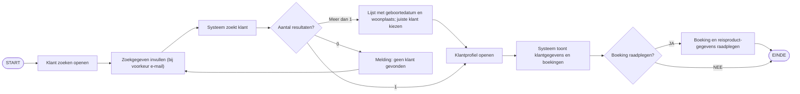

### UC-K02 Klantcontact registreren
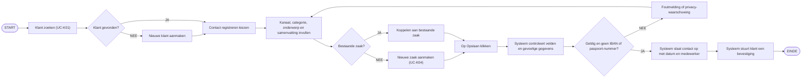

### UC-K03 Klantdossier en contactgeschiedenis raadplegen
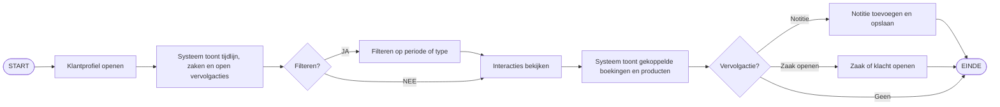

### UC-K04 Klantzaak beheren
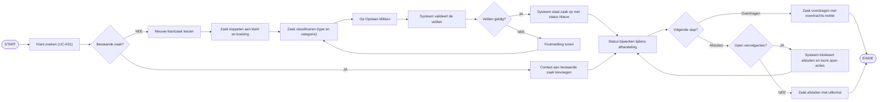

### UC-K05 Klantzaken prioriteren en toewijzen
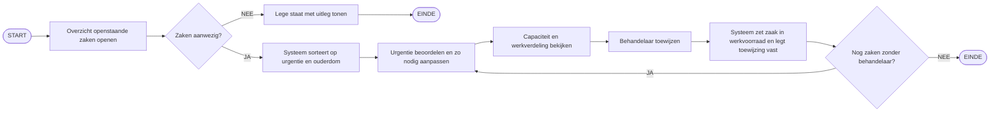

### UC-K06 Werkvoorraad en reactietijden bewaken
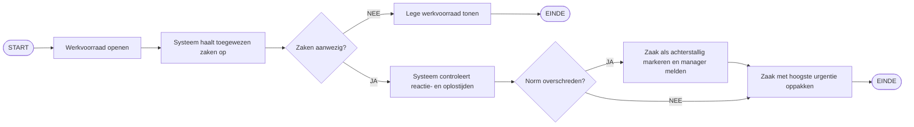

### UC-K07 Klantvraag onderzoeken en beantwoorden
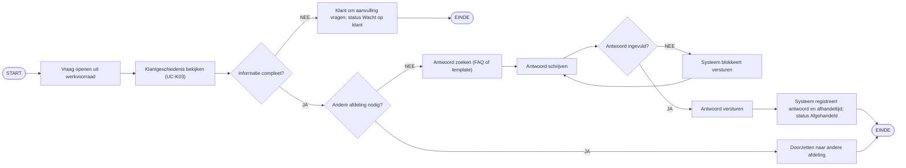

### UC-K08 Klacht volgens vaste werkwijze afhandelen
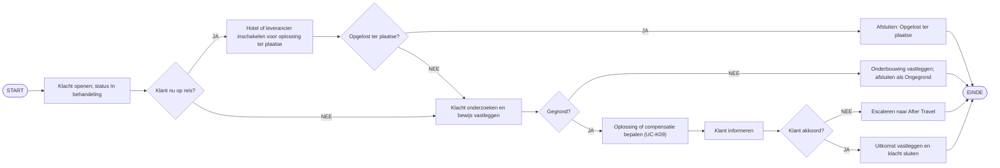

### UC-K09 Oplossing of compensatie vastleggen
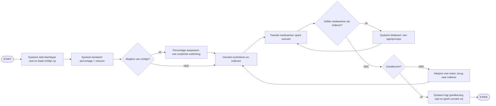

### UC-K10 Klant informeren en zaak opvolgen
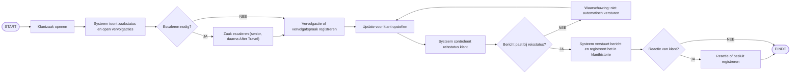

### UC-K11 Klachten en klantfeedback analyseren
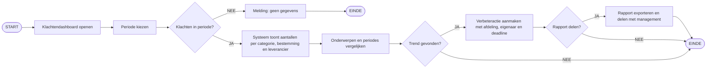

### UC-K12 Klantgegevens en bewaartermijnen beheren
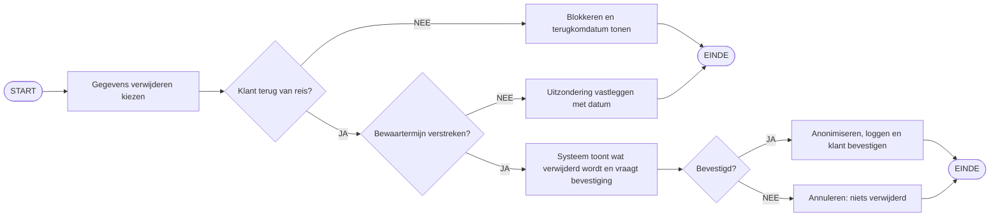

### UC-K13 Privacy en gevoelige gegevens bewaken
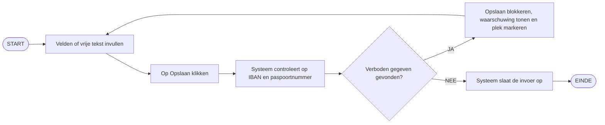
